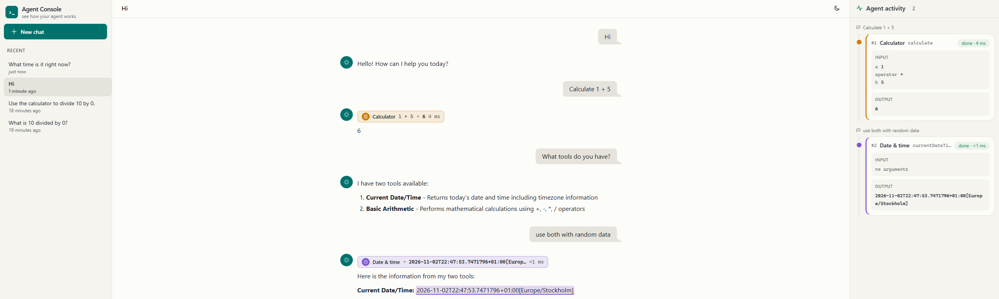

# agent-fredrik

A small local chat agent built with [LangChain4j](https://docs.langchain4j.dev):

- **Model:** `qwen3.5:2b` served by Ollama in Docker, with thinking mode on. Only the final answer is shown or stored.
- **Memory:** per-conversation chat history in Redis (last 20 messages). Redis runs without persistence, so memory survives agent restarts but not Redis restarts.
- **Tools:** current date/time, and a calculator (`+ - * /`).

## Prerequisites

- Docker Desktop (running)
- JDK 25 and Maven

## Start the runtime

```bash
docker compose up -d
```

This starts Ollama and Redis. A one-shot `ollama-init` service pulls `qwen3.5:2b` into the named Docker volume `ollama`. The **first run downloads ~2.7 GB**. Later runs reuse the volume and skip the download. To wait for the model:

```bash
docker compose logs -f ollama-init   # ends with "success"
```

## Run the agent

```bash
mvn -q compile exec:java                          # conversation id "default"
mvn -q compile exec:java -Dexec.args=my-session   # pick a conversation id
```

Type `/quit` to exit. Restarting with the same conversation id continues that conversation.

Connection settings can be overridden with environment variables: `OLLAMA_BASE_URL` (default `http://localhost:11434`), `REDIS_HOST` (`localhost`) and `REDIS_PORT` (`6379`).

## Web UI

The browser chat lives in its own module, [`chat-ui/`](chat-ui/README.md). It streams replies and shows every tool call inline and on an activity timeline.

 It talks to the agent only through the HTTP contract in [`chat-ui/API.md`](chat-ui/API.md), so the backend can be swapped.

```bash
mvn -q compile exec:java@server     # chat API on http://localhost:8080/api  (AGENT_HTTP_PORT to change)
cd chat-ui && npm install && npm run dev   # UI on http://localhost:5173
```

The server uses the same model, tools and Redis memory as the CLI, so a conversation can be continued from either side (the conversation id is in the UI's URL after `#/c/`). It also keeps a small conversation index in Redis (`chat:conversations`, `chat:conversation:{id}`) for the sidebar. CLI-only conversations aren't listed until they get a message through the server. The UI shows only what is still in the 20-message memory window.

## Tests

```bash
mvn test
```

The UI has its own tests: `cd chat-ui && npm test`.

The Java tests don't need the Compose stack. They start their own Ollama (Testcontainers Ollama module) and Redis containers. The test Ollama container mounts the same `ollama` volume, so it pulls the model only if it isn't there yet. A run takes about 2 minutes on CPU.

`ComposeImageTagsTest` checks that `docker-compose.yaml` and the tests use the same image versions (`AgentConfig.OLLAMA_IMAGE`, `AgentConfig.REDIS_IMAGE`). Update both together when you upgrade.

## Stop

```bash
docker compose down          # keeps the downloaded model (volume "ollama")
```
