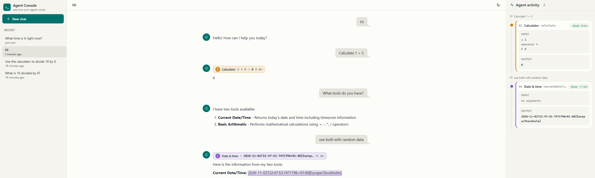

# chat-ui

A browser chat UI for the agent that **shows how the agent works**. Every tool call appears in
three linked places:

- an **inline marker** in the reply, at the point where the agent called the tool,
- **highlighted text** wherever the answer repeats the tool's result (numbers also match with
  thousands separators, e.g. `7006652` ↔ `7,006,652`),
- a **card on the activity timeline** on the right: input, output, status and duration.

Hover any of them to light up the others. Click one to scroll to the matching card or marker.



The UI only knows the HTTP contract in [`API.md`](./API.md). It has no dependency on the Java
code, so any backend that implements the contract can replace the bundled LangChain4j agent.

## Run

Requires Node.js 20+ and a running backend (see the root README).

```bash
npm install
npm run dev            # http://localhost:5173
```

The app calls relative `/api/...` and the Vite dev server proxies it to the backend:

| Variable | Default | Meaning |
|---|---|---|
| `CHAT_API_URL` | `http://localhost:8080` | Backend that implements `API.md` |

```bash
CHAT_API_URL=http://localhost:9000 npm run dev      # point at another backend
```

For a static build, run `npm run build` and serve `dist/` behind any web server that forwards
`/api` to the backend (`npm run preview` does that locally with the same variable).

## Test

```bash
npm test               # Vitest: SSE parser, stream reducer, API client, highlighting, store, components
npm run build          # type-check (vue-tsc) + production build
```

## Layout of the code

| Path | What it does |
|---|---|
| `src/api/` | Contract types, `fetch` client, SSE parser (POST streams can't use `EventSource`) |
| `src/chat/reducer.ts` | Pure fold of stream events into ordered message parts (text / tool) |
| `src/composables/store.ts` | Conversations, active id (URL hash), per-conversation messages, streaming |
| `src/composables/useToolHighlight.ts` | Hover/selection linking between marker, spans and cards |
| `src/lib/highlight.ts` | Wraps tool results found in the answer's text nodes in `<mark>` |
| `src/components/` | Sidebar, chat, inline tool marker, activity panel |
| `src/style.css` | Tailwind + daisyUI with the custom `console-light` / `console-dark` themes |

## Limits

- History shows what the backend still remembers. The bundled agent keeps a 20-message window
  per conversation, and tool calls take up part of that window.
- Conversations started from the CLI appear in the sidebar only after they get a message
  through the web UI.
- Tools signal failures as text starting with `Error`, and the UI shows those calls as failed.
